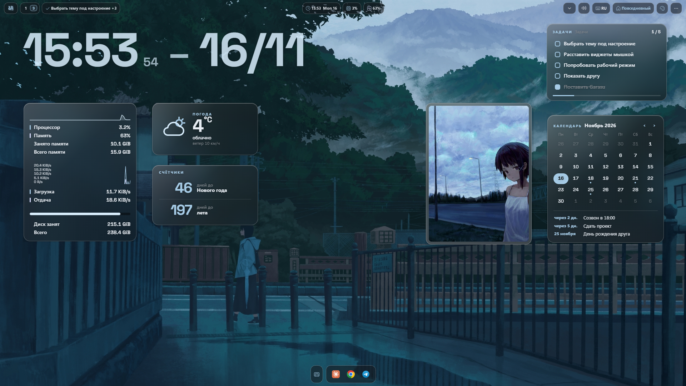

# 硝 Garasu

**Рабочий стол Windows 11 в стиле стекла: окна плиткой, панель и док, виджеты на обоях, темы из обоев и три режима работы.** Ставится одним установщиком и одним ярлыком удаляется.

> *Garasu (硝子) по-японски «стекло».* Проект вдохновлён Linux-окружением [Ryoku](https://ryoku.dev) и переносит его идеи на Windows. Это независимая работа, с Ryoku не связанная.

<!-- Сюда главный скриншот: docs/screenshots/desktop.png -->


## Что внутри

- **Окна плиткой.** Окна сами делят экран, рабочие столы переключаются с клавиатуры (GlazeWM).
- **Панель и док.** Сверху прозрачная панель с «таблетками», снизу док с открытыми окнами и текущим треком. Док умеет прятаться.
- **Виджеты на обоях.** Часы (три вида), системный монитор, плеер с обложкой, текстом песни и визуализатором, задачи из Markdown-заметки, календарь с заметками, таймер помодоро, погода, счётчики дней, фоторамка.
- **Виджеты двигаются мышкой.** Клик выделяет виджет: тащи, чтобы перенести, тяни за уголок, чтобы изменить размер. Есть привязка к краям и другим виджетам.
- **Темы из обоев.** Цвета панели, рамок окон и виджетов считаются из картинки. Своя картинка тоже подходит.
- **Матовое стекло.** Под карточками виджетов размытые обои, как у настоящего стекла.
- **Три режима.** Повседневный, рабочий (задачи, календарь, таймер) и игровой (виджеты закрыты, питание на максимум). Игровой включается сам при запуске игры из Steam.
- **Микшер громкости** по приложениям и **календарь с заметками** по клику на часы.

## Установка

Нужны Windows 11 и интернет.

1. Скачай `Garasu-Setup.exe` со страницы [Releases](../../releases) и запусти.
2. Если Windows покажет синее окно «Система Windows защитила ваш компьютер», нажми «Подробнее» → «Выполнить в любом случае» (файл не подписан).
3. Нажми «Установить» и подожди 5–10 минут. На вопросы Windows об установке программ отвечай «Да».

Установщик сам поставит недостающие программы через winget: [GlazeWM](https://github.com/glzr-io/glazewm), [YASB](https://github.com/amnweb/yasb), [Zebar](https://github.com/glzr-io/zebar), [AutoHotkey](https://www.autohotkey.com) и Python. Файлы кладутся в `C:\garasu`, прежние настройки сохраняются в `C:\garasu\backup`.

Без exe: скачай репозиторий архивом, распакуй и запусти `Установить.bat`.

### Удаление

Ярлык «Удалить Garasu» на рабочем столе. Вернутся панель задач, меню «Пуск», прежние настройки и обои. Сами программы остаются, их можно убрать через «Параметры → Приложения».

## Как пользоваться

| Действие | Как |
| --- | --- |
| Поиск приложений | клавиша `Win` |
| Темы, режим дока, настройки виджетов | кнопка с палитрой на панели |
| Режим: повседневный / рабочий / игровой | кнопка режима на панели или `Ctrl+Alt+1` / `2` / `3` |
| Перенести или растянуть виджет | клик по виджету, потом тащить или тянуть за квадратик |
| Настройки виджета | клик по виджету → шестерёнка |
| Календарь с заметками | клик по часам на панели, правый клик по числу |
| Микшер громкости | правый клик по значку громкости |
| Рабочий стол 1–9 | `Alt+1…9`, перенести окно: `Alt+Shift+1…9` |
| Соседнее окно | `Alt+стрелки`, передвинуть: `Alt+Shift+стрелки` |
| Закрыть окно | `Alt+Shift+Q` |
| Окно на весь экран | `Alt+F` |
| Пауза плитки | `Alt+Shift+P` |
| Следующая тема | `Alt+Shift+T` |

## Что уходит в интернет

Всё работает локально. В сеть обращаются только:

- плеер: название трека и исполнитель отправляются на lrclib.net и music.163.com (текст песни) и в каталоги iTunes и Deezer (обложка). Отключается галочками «Текст песни» и «Обложка»;
- погода: место определяется по интернет-адресу (встроенная функция Zebar);
- установщик: скачивает программы через winget и обои с GitHub.

## Известные ограничения

- Проверено на одном компьютере: Windows 11, экран 1920×1080, масштаб 100%. На другом масштабе виджеты могут встать неровно.
- Память: около 1,1 ГБ с шестью виджетами, около 260 МБ в игровом режиме.
- Размытие под виджетами берётся из обоев темы, поэтому с живыми обоями (Lively, Wallpaper Engine) не совпадает.
- Системная панель задач делается невидимой, а не отключается.

## Как устроено

```
files/
  install.ps1, uninstall.ps1   установщик и удаление
  start.bat                    запуск при входе в Windows
  glazewm-config.yaml          плитка окон и клавиши
  theme/                       Python: темы (ryoku.py), режимы (mode.py), виджеты (widgets.py),
                               фоновый помощник (helper.pyw), панели настроек (*_panel.pyw)
  zebar/                       виджеты на обоях: HTML, CSS, JS
```

Тема применяется командой `python C:\garasu\theme\ryoku.py <тема|next|путь к картинке>`.

## Благодарности и лицензия

Спасибо авторам [Ryoku](https://github.com/ryoku-dev/ryoku) за идею и вид, а также авторам GlazeWM, YASB и Zebar, на которых всё держится. Подробности в [CREDITS.md](CREDITS.md).

Код распространяется по лицензии [GPL-3.0](LICENSE).

---

**English.** Garasu is a glass-styled desktop for Windows 11: tiling windows (GlazeWM), a pill bar and dock (YASB), draggable desktop widgets (Zebar), wallpaper-based themes and three modes (daily, work, game). Inspired by the Linux desktop [Ryoku](https://ryoku.dev); not affiliated with it. Download `Garasu-Setup.exe` from Releases and click Install. The interface is in Russian.
